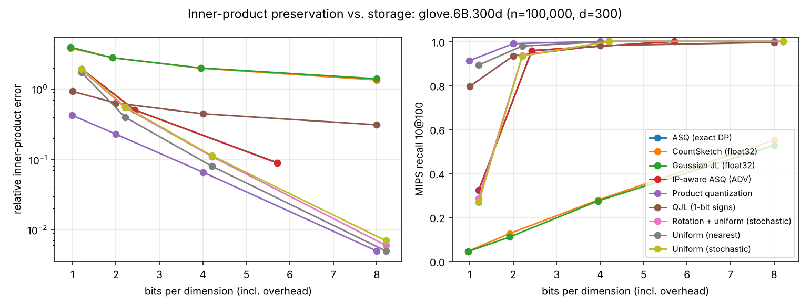
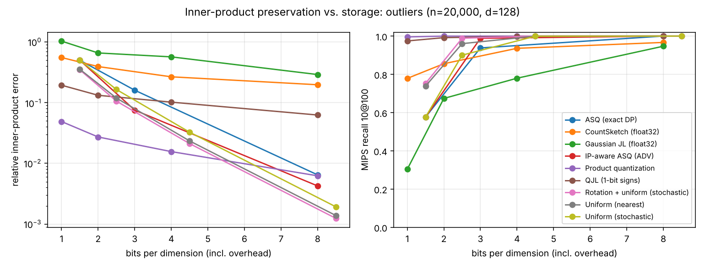

# ip-sketch-bench

**How well do vector compression schemes preserve inner products?**

Inner products are the core operation behind attention, retrieval and maximum-inner-product search (MIPS). Every KV-cache compressor, embedding quantizer and vector index trades memory for inner-product accuracy. This repo compares nine such schemes on the same footing: the same bit budget (with per-vector overhead counted), the same data, and the same metrics.

| Family | Methods |
|---|---|
| Scalar quantization | uniform with nearest rounding; uniform with stochastic (unbiased) rounding; random rotation + stochastic uniform; **adaptive stochastic quantization (ASQ)** with an exact O(s·d²) dynamic program; **inner-product-aware ASQ**, which weights each coordinate by the queries' second moment |
| Sketches | Gaussian Johnson–Lindenstrauss; CountSketch; **QJL**, 1-bit signs of a JL projection plus the norm |
| Learned codebooks | product quantization (k-means, 256 codes per block) |

Queries stay at full precision. That's the asymmetric setting used in vector search and in KV-cache attention, where the query is fresh and the keys are stored compressed.

## Inner-product-aware ASQ: when weighting by the queries helps

Plain ASQ picks each vector's quantization levels to minimize squared error, treating every coordinate equally. With unbiased rounding, though, the error in an inner product with a query x is

```
Var[<ŵ, x>] = Σᵢ xᵢ² · VarSSQ(wᵢ, Q)
```

so averaging over queries weights coordinate i by λᵢ = E[xᵢ²]. Minimizing that weighted objective is the average-case (ADV) objective of White & Singal, *Inner Product Aware Quantization* (NeurIPS 2026, arXiv:2606.00289). `InnerProductAwareASQ` implements it exactly. The DP is plain ASQ's, run over weighted prefix sums Σλ, Σλw and Σλw², and λ is estimated from the database as a stand-in for the query distribution. The tests check its levels against brute-force search, check that it reduces to plain ASQ when every λᵢ = 1, and check that it's unbiased.

| Dataset | Bits/dim | ASQ: IP error / recall@10 | IP-aware ASQ: IP error / recall@10 |
|---|---:|---:|---:|
| Outlier channels (d = 128) | 3.0 | 0.161 / 0.557 | **0.075 / 0.777** |
| Outlier channels (d = 128) | 8.0 | 0.006 / 0.986 | **0.004 / 0.991** |
| GloVe-300 | 2.43 | 0.507 / 0.580 | 0.506 / 0.578 |
| GloVe-300 | 5.71 | 0.090 / 0.911 | 0.089 / 0.911 |

At 1 bit the two are identical, because both levels must be the vector's min and max.

**The gain depends on how concentrated the query energy is.** On the outlier-channel data, weighting cuts inner-product error by 53% at the same storage and raises recall@10 from 0.56 to 0.78. On GloVe it changes nothing. The second moments explain why:

| | Outlier channels | GloVe-300 |
|---|---:|---:|
| max λᵢ / median λᵢ | 643 | 3.9 |
| share of query energy in the top 3% of dimensions | 85% | 6% |

When the query energy is spread almost evenly, the weights are nearly uniform and the objective collapses to plain ASQ. The setting where weighting should matter most is one where a few channels dominate, which is what transformer keys and queries look like, so the next experiment is LLM KV caches.

Encoding costs the same as ASQ, since it's the same O(s·d²) DP. The paper's faster algorithms are the next step (see [`docs/ipasq.md`](docs/ipasq.md)). In the GloVe CSV, IP-aware ASQ's encode times come from a 2-core cloud VM, and every other method's from the M5 Max. On that VM, plain ASQ took 32 s at 4 bits, compared with 13.8 s on the M5 Max.

## Results: GloVe-300 word embeddings (real data)

The dataset is 100,000 GloVe 6B 300-d vectors as the database and 1,000 held-out vectors as queries. ASQ is evaluated on the first 20,000 vectors because of its O(4ᵇ·d²) dynamic program. The run took a few minutes on an Apple M5 Max, and the raw log is in [`results/glove.6B.300d.log`](results/glove.6B.300d.log).



| Method | Bits/dim (incl. overhead) | Relative IP error | MIPS recall 10@100 | Encode time (M5 Max) |
|---|---:|---:|---:|---:|
| Uniform, nearest rounding | 1.21 | 1.726 (bias +0.457) | 0.893 | 0.04 s |
| Uniform, stochastic | 1.21 | 1.939 | 0.268 | 0.21 s |
| **QJL (1-bit)** | **1.00** | **0.930** | **0.795** | 0.15 s |
| **Product quantization** | **0.99** | **0.426** | **0.912** | 12.0 s |
| Uniform, nearest rounding | 2.21 | 0.400 | 0.979 | 0.05 s |
| Uniform, stochastic | 2.21 | 0.565 | 0.933 | 0.22 s |
| Rotation + uniform (stochastic) | 2.21 | 0.549 | 0.935 | 0.31 s |
| ASQ, exact DP | 2.43 | 0.507 | 0.958 | 2.6 s |
| Gaussian JL (float32) | 1.92 | 2.787 | 0.110 | < 0.01 s |
| CountSketch (float32) | 1.92 | 2.797 | 0.126 | < 0.01 s |
| QJL | 2.00 | 0.635 | 0.934 | 0.31 s |
| **Product quantization** | **2.00** | **0.229** | **0.990** | 7.6 s |

### What the GloVe numbers show

1. **Product quantization is the most accurate at every budget on real data too.** At 1 bit per dimension it reaches 0.912 recall 10@100, and at 2 bits it reaches 0.990, but it took 8–26 s to encode on an M5 Max, compared with well under a second for the data-oblivious methods.
2. **Unbiased doesn't mean better for search.** At 2 bits, plain nearest rounding beats stochastic rounding on both inner-product error (0.400 vs. 0.565) and recall (0.979 vs. 0.933). Stochastic rounding removes bias by adding variance, and for ranking, variance hurts more than a small bias does. At 1 bit the trade-off turns harsh: nearest rounding still ranks well (0.893), but its inner products are biased by +46%. Unbiasedness matters when inner products feed a sum, as in attention, and it matters less for top-k search.
3. **QJL is again the best data-oblivious method at 1 bit** (0.795 recall, compared with 0.27–0.32 for the stochastic scalar quantizers at 1.21 bits). It's weaker than on the synthetic data, though, and by 2 bits nearest rounding overtakes it.
4. **Rotation's benefit depends on the data.** GloVe has no dominant outlier channels, so a random rotation barely helps (0.549 vs. 0.565 error at 2 bits). On the outlier-channel data, the same rotation cut error by 35%.
5. **ASQ helps modestly on real data.** With d = 300, its per-vector level table costs less (2 bits becomes 2.43 bits/dim). It cuts inner-product error by 10% compared with stochastic uniform (0.507 vs. 0.565) and raises recall to 0.958, at about 12× the encoding time. Its objective is still squared error rather than inner products.
6. **Spending the budget on full floats loses everywhere.** JL and CountSketch with float32 coordinates stay below 0.13 recall at 2 bits/dim.

The full table is in [`results/glove.6B.300d.csv`](results/glove.6B.300d.csv).

## Results: synthetic embeddings with outlier channels

The dataset is 20,000 database vectors and 500 queries in d = 128. Per-dimension scales are log-normal, and four channels are 20× larger, similar to the outlier features in transformer activations and KV caches. Reproduce it with `python -m ipsketch.bench --dataset outliers --asq-n 20000`.



| Method | Bits/dim (incl. overhead) | Relative IP error | MIPS recall 10@100 | Encode time |
|---|---:|---:|---:|---:|
| Uniform, nearest rounding | 1.5 | 0.355 | 0.738 | 0.02 s |
| Uniform, stochastic | 1.5 | 0.501 | 0.576 | 0.03 s |
| Rotation + uniform (stochastic) | 2.5 | 0.106 | 0.989 | 0.03 s |
| ASQ, exact DP | 3.0 | 0.161 | 0.938 | 1.6 s |
| Gaussian JL (float32) | 2.0 | 0.660 | 0.674 | < 0.01 s |
| CountSketch (float32) | 2.0 | 0.394 | 0.855 | < 0.01 s |
| **QJL (1-bit)** | **1.0** | **0.194** | **0.975** | 0.01 s |
| **Product quantization** | **1.0** | **0.049** | **0.996** | 4.2 s |

Full results for every method at 1, 2, 4 and 8 bits are in [`results/outliers.csv`](results/outliers.csv), and the isotropic Gaussian control is in [`results/isotropic.csv`](results/isotropic.csv).

### What the numbers show

1. **Learned codebooks win on accuracy, at a cost.** Product quantization is the most accurate at every budget, but it has to be trained on the data, and it encodes hundreds to thousands of times slower than the data-oblivious methods (4–18 s vs. under 0.15 s here). That cost matters for KV caches, which are written once per generated token.
2. **QJL is the best data-oblivious method at 1 bit per dimension.** Signs of a Gaussian projection plus one norm reach 0.975 recall 10@100 at 1.0 bits/dim. Uniform quantization reaches 0.74 even with 1.5 bits/dim. Its error then shrinks slowly with more bits, because each sign carries at most one bit of information.
3. **Spending the budget on full floats is wasteful.** At a fixed bit budget, JL and CountSketch that store float32 coordinates keep only b·d/32 dimensions, and they're the worst methods at every budget. Spending bits on quantization beats spending them on extra projection dimensions.
4. **Rotation fixes outlier channels.** A random orthogonal rotation before stochastic rounding spreads the outliers across all dimensions. At 2 bits it cuts inner-product error from 0.165 to 0.106 and raises recall 10@100 from 0.90 to 0.99, for one extra matrix multiply.
5. **Minimizing squared error isn't the same as preserving inner products.** ASQ picks per-vector levels that minimize quantization variance, and it does cut variance about 6× compared with uniform levels on this data (verified in the tests). Yet its inner-product error barely moves (0.161 vs. 0.165 at 2 bits). The queries share the same outlier channels, so the inner-product error is dominated by a few coordinates that the variance objective weights no more heavily than the rest. ASQ also pays for its level table, so 2 bits becomes 3.0 bits/dim and 4 bits becomes 8.0. This gap is what *inner-product-aware* quantization targets; see the section above, where weighting by the queries cuts the 2-bit error to 0.075.

All the stochastic methods and sketches are unbiased: their measured bias is within ±0.002 of the true inner product, and the tests check this.

## Run it on GloVe

The real-data run uses GloVe 300-d word vectors, an 822 MB download:

```bash
./scripts/download_glove.sh                       # downloads data/glove.6B.300d.txt
python -m ipsketch.bench --glove data/glove.6B.300d.txt --n 100000 --nq 1000 \
    --bits 1 2 4 8 --asq-n 20000
```

ASQ's exact DP is O(4ᵇ·d²) per vector, so `--asq-n` evaluates it on a subset.

## Install and test

```bash
pip install -e ".[dev]"
pytest
```

The tests check that:
- every stochastic quantizer and sketch is unbiased, averaged over 3,000 seeds;
- the ASQ dynamic program matches brute-force search over all level sets;
- ASQ beats uniform levels on squared error, and rotation beats plain uniform rounding on outlier data;
- inner-product-aware ASQ's levels match brute-force search, it reduces to ASQ when every λᵢ = 1, and it beats ASQ by more than 10% on outlier-heavy queries;
- every method's reported bits per vector matches the budget it claims.

## Roadmap

- [x] GloVe-300 results at 100K vectors
- [x] Inner-product-aware adaptive quantization (ADV objective, exact DP), following White & Singal (NeurIPS 2026)
- [ ] The paper's fast exact and approximate ADV algorithms, plus the worst-case (MDV) objective
- [ ] Estimate λ from a small query sample instead of the database
- [ ] Two-stage schemes: MSE quantizer + 1-bit QJL on the residual (TurboQuant-style)
- [ ] Apply the best methods to a real LLM's KV cache (next project: `sketchkv`)

## License

Copyright (c) 2026 Mitesh Patel. All rights reserved.
